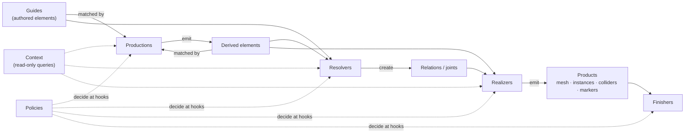
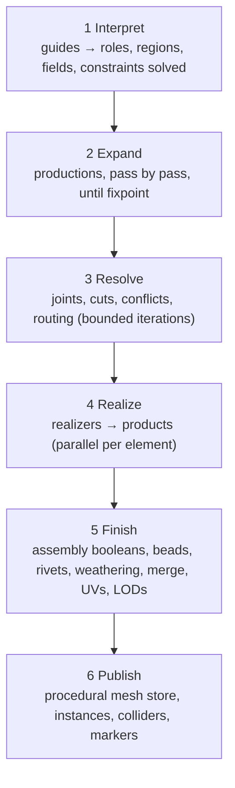
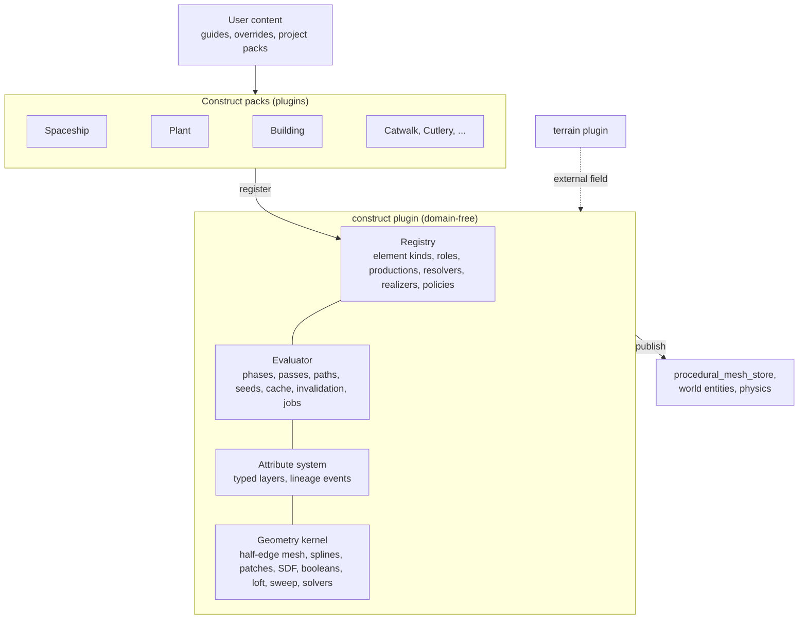

# Procedural Construction (`construct` plugin)

> **Status: proposal.** Nothing is implemented. It builds on [procedural_geometry.md](procedural_geometry.md) (the
> procedural mesh store, provided LODs, baking), follows the plugin / node-pack pattern of
> [terrain_generation.md](terrain_generation.md) (custom plugin, editor extension API, packs registered by reflection) and
> uses the reflection conventions of [scripting.md](scripting.md). Rigged / skinned meshes are out of scope.
>
>
> **Interface:** [procedural_construction_interface.md](procedural_construction_interface.md) fixes the C++ API for packs.
> Where the two documents differ, the interface document wins.
>
> **Decided** (every choice goes to the packs):
> - Pack code is **C++26 only**, with reflection for tag schemas, kinds and parameters. No node graph.
> - Booleans and meshing: **both** an exact mesh backend (Manifold) and an in-house SDF backend, plus pack backends,
>   chosen per operation; one result can mix them.
> - Joint ownership: **per joint**: side A, side B, both, and / or a separate joint realizer.
> - Policy composition: **per hook**: first match, chain, merge or all; packs can change a hook's composition.
> - Packs can **insert, wrap and replace pipeline stages** (core stages included), and add passes.
> - Final topology: **chosen by packs, several outputs at once**, each with its own topology and purpose.

The construct plugin turns a rough, tagged description of an object into finished static geometry. The user places
**guides** (volumes, splines, surfaces, points), tags them, and picks a **construct pack** (Spaceship, Plant, Building,
Catwalk, Cutlery, ...). Productions defined by the pack expand the guides into an abstract structure (frames,
branches, floors, posts). Relations settle how parts touch. Realizers then build meshes, instances, colliders and
markers, which go into the procedural mesh store like any other procedural geometry.

The core knows nothing about ships or plants. It provides the data model, the evaluation machinery, the geometry
kernel and **hooks**. Everything domain-specific, including *how attributes propagate*, is supplied by packs.

## Answers in short

| Question | Proposal |
|---|---|
| What does the user author? | **Guides** of any dimension: points / frames (0D), splines (1D), surfaces / planes (2D), volumes (3D). Each guide has a **role** (envelope, reservation, skeleton, path, silhouette, cutter, ...) and **tags**, also on sub-regions (faces, spans of a spline) |
| What turns guides into a mesh? | Four kinds of pack code: **productions** expand elements into more elements, **resolvers** create relations (joints) between them, **realizers** turn an element into products (mesh, instances, collider, markers), **finishers** post-process the whole assembly |
| How generic is the core? | One unified object, the **element** (authored guides are elements too). Productions are matched on element kind + tags, so ship frames, L-system plants and building split grammars are the same mechanism |
| How do packs change behaviour? | Through **policies** at core hooks: attribute propagation, conflict resolution, interface matching, sampling, seeding, meshing, partitioning, merging, UVs, LODs. Looked up by element, then tag, then pack, then global |
| Plants from splines and planes? | Yes: splines are skeleton guides (radius / twist / tags along them), planes are leaf, frond or silhouette guides. Productions add the procedural part (twigs, leaves, roots) around what was drawn. See "Plants from splines and planes" |
| Can it make any static mesh? | The domain check below goes through 13 domains and lists 14 gaps found in the first draft, each with the addition that closes it. What stays out of scope is listed honestly |
| Where does the output go? | `procedural_mesh_store` (one mesh per spatial partition × material group, `occasional` while editing), plus mesh-asset instances as entities, colliders and marker data. "Bake" works exactly as for terrain |
| Where is it stored? | Asset `glt.construct` (`.glt_construct`). A world references it with a `construct.instance` component (asset, seed, overrides, live / baked) |
| How do users add their own logic? | In **C++ only** (no node graph). **Construct packs**: custom plugins in `<project>/plugins/construct_pack_<name>/`, registered with `construct::register_pack<^^namespace>("name")`. Packs can extend other packs. Per-project tweaks are tiny packs too |

## The unified model

One sentence: **a construct is a set of tagged elements that productions expand, relations connect and realizers turn
into products, with every domain decision delegated to policies.**



### Element

Every object that flows through the system is an element: immutable data, no behaviour.

| Field | Meaning |
|---|---|
| `path` | Stable id: the path of what created it, e.g. `hull/frames/station[12]/rib`. Seeds, caches and overrides key on it |
| `kind` | Name of the element type (`guide.volume`, `ship.rib`, `plant.branch`, `building.floor`). Kinds are declared by the core (guides) or a pack |
| `shape` | One of: `point`, `frame`, `curve`, `surface`, `volume`, `graph`. Abstract geometry, not yet a mesh |
| `tags` | Typed attributes on the element and on its sub-regions (face sets of a volume, parameter spans of a curve, patches of a surface) |
| `params` | Kind-specific parameters (flange depth, branch radius, step height) |
| `pass` | Which expansion pass produced it |
| `origin` | `authored` (a guide) or `derived` (produced by a production) |

### Guides: authored elements of every dimension

The first draft only had volume primitives. That is not enough for plants, roads, cables, wings or leaves, so guides
cover all four dimensions. A pack declares which **roles** it understands; the core ships a neutral set.

| Dimension | Guide shapes | Editing | Core roles | Examples |
|---|---|---|---|---|
| 0D | point, frame (point + orientation) | place, snap | `marker`, `socket`, `attractor`, `anchor` | flower position, hinge, cockpit seat, root anchor, spawn point |
| 1D | spline (Bezier / Catmull-Rom / polyline), curve network | draw, edit control points, per-point attributes | `skeleton`, `path`, `profile`, `section`, `edge` | trunk, branch, road centre line, pipe run, wing spar, fork profile, fuselage section |
| 2D | plane, quad patch, trimmed patch, surface from curves | place, transform, loop cut, trim | `silhouette`, `leaf`, `facade`, `floor`, `deck`, `membrane` | leaf cluster, frond, crown outline, building facade, ship deck, sail |
| 3D | box, cylinder, sphere, capsule, cone, torus, extruded profile, mesh cage | transform, loop cut, extrude, edit regions | `envelope`, `reservation`, `cutter`, `void`, `solid` | hull, reactor, room, door opening, rock to wrap around, tunnel volume |

Common to all guides:

- **Edit stack.** Transforms, loop cuts, extrusions and region assignments are recorded steps, not baked geometry, so
  propagation policies can run on them (see Policies) and the guide can be re-edited.
- **Region tags.** Any subset (faces of a volume, a span `t ∈ [0.3, 0.7]` of a spline, a patch of a surface) carries
  its own tags. This is how "only this part of the hull is armoured" or "this span of the branch is bare" is expressed.
- **Symmetry and arrays** are guide modifiers (mirror plane, radial count, linear count). Derived elements keep a
  `mirror_of` relation, so a policy can decide whether a mirrored side gets its own seed.
- **Constraints** between guides (equal length, coincident, tangent, attached to) are relations solved before expansion
  (G10).

### Relations

A relation is a typed, directed link between two elements (or an element and a guide region). The core defines a few
kinds; packs add their own.

| Relation | Created by | Meaning |
|---|---|---|
| `child_of` | productions | Hierarchy: a twig is a child of a branch, a rib is a child of a frame station |
| `constraint` | user, productions | Equal, coincident, tangent, symmetric, aligned. Solved in Interpret |
| `joint` | resolvers | Two elements touch: weld, bolt, notch, fork, mortise, clearance, ... with contact geometry and parameters |
| `attach` | user, productions | Element sits on a socket of another (railing post on a catwalk deck) |
| `cut` | resolvers | A cutter removes material from an element (door through wall and plating) |

Both elements of a joint read it during realization. That is what makes a rib look welded into a backbone instead of
placed next to it.

### Productions

A production is pack code with a **match** and an **expand**: it matches elements by kind, shape, tags or role, reads the
Context, and emits new elements and relations. Productions run in named **passes** (`primary`, `secondary`, `detail`,
or pack-defined), and within a pass they repeat until nothing new matches or a depth limit is reached.

This one mechanism covers:

- Ship frames: match `guide.volume[role=envelope]`, emit `ship.frame_station` every N m, which then matches the rib
  production.
- L-systems and plant growth: match `plant.branch` at depth d, emit child branches at depth d+1.
- Split grammars (buildings): match `building.facade` surface, split it into floors, then bays, then windows.
- Catwalks: match `guide.curve[role=path]`, emit deck segments, posts and railing runs.

### Realizers and products

A realizer is the terminal step for one element kind. It reads the element, its relations and the Context, and emits
**products**:

| Product | Content | Goes to |
|---|---|---|
| `mesh_fragment` | Triangles with attributes, a material per triangle group | merged per partition, then `procedural_mesh_store` |
| `instances` | Transforms plus a mesh asset reference (bolt, railing post, leaf card, chair cushion from a kit) | entities with `component::mesh`, later instance batches |
| `collider` | Simplified convex or triangle shape | physics (later) |
| `marker` | Named frame with tags (seat, door hinge, light, nav link, spawn point) | data on the construct instance, readable by game code |
| `decal` | Projected decal or detail-texture placement | renderer (later) |

### Context

The read-only query API that productions, resolvers and realizers receive. They get nothing else, which keeps them
deterministic, parallel and testable.

| Query | Returns |
|---|---|
| `inside(p, role?)`, `distance(p, role?)` | Signed distance to volumes of a role |
| `closest(p, filter)`, `raycast(ray, filter)` | Hit point, normal, owning element, tags |
| `slice(plane, filter)` | 2D contours of volumes in that plane, with tags per contour segment |
| `sample_curve(element, t)` | Position, frame, interpolated attributes along a curve |
| `elements(filter)` | Elements from earlier passes, by kind, tag, region |
| `relations(element, kind?)` | Relations touching an element |
| `field(name, p)` | Any registered field: SDFs, pack fields (light, stress), **external fields** (terrain height) |
| `route(a, b, constraints)` | A path through the void (G6) |
| `rng(salt)` | Deterministic random stream seeded from the caller's path |
| `policy<hook>()` | The policy in effect for the caller's scope |

Every query is recorded with the region it read, which drives incremental re-evaluation.

## Pipeline



| # | Phase | Reads | Writes | Pack code | Cost |
|---|---|---|---|---|---|
| 1 | Interpret | Guides, edit stacks | Classified volumes / curves / surfaces, SDFs and fields, solved constraints, void | role classifiers, field providers | low |
| 2 | Expand | Phase 1, earlier passes | Derived elements, `child_of` / `attach` relations | productions | low to medium |
| 3 | Resolve | Phases 1 and 2 | Joints, cuts, trimmed or culled elements, routes | resolvers, interface types | medium |
| 4 | Realize | Elements plus their relations | Products | realizers | high |
| 5 | Finish | All products | Final products | finishers | medium |
| 6 | Publish | Final products | Store entries, entities | none (core) | low |

Rules that keep this deterministic and incremental:

- A phase reads only the outputs of earlier phases and earlier passes.
- Inside Expand and Resolve, repetition is allowed but **bounded**: a fixpoint with a depth or iteration limit, and an
  error marker on the element that hit it.
- Phases 1–3 work on abstract data and should stay interactive while a guide is dragged. Phases 4–5 run as jobs on
  `GLT::thread_pool` and stream in; the editor shows element proxies until then.
- A realizer can host a **nested construct** in its local frame (a cargo container, a cockpit module, a flower). The
  nested construct uses its own pack and policies.

## Plants from splines and planes

The user draws the plant's character and the pack fills in the rest. Drawn parts are never overwritten. They are the
skeleton that productions grow from.

```
   AUTHORED (guides)                 EXPANDED (elements)                    REALIZED (products)

        ▭ leaf plane                      ▭ ⟋⟋ leaf cards scattered            bark mesh with smooth
       ╱                                 ╱  ╲ on the plane, facing             fork junctions,
  ~~~~╱  branch spline              ~~~~╱ ╲╲ twigs added along              leaf-card instances,
      │  (radius 0.12 → 0.03)           │   ╲ the drawn branch                 radius tapers along
      │                                 │                                    every spline
   ┃  trunk spline                    ┃  ╲ fork joint at the snap point
   ┃  (radius 0.4 → 0.15)             ┃
 ══╋══ ground plane                ══╋══ roots grown toward anchors
   ╵   (root_anchor)                  ╲╵╱
```

1. **Splines are branches.** A spline with role `skeleton` becomes a `plant.branch` element. Per-control-point
   attributes: `radius`, `twist`, and any tag (`bark_age`, `bare`, `no_twigs`). A branch whose start point is snapped
   onto another spline gets a `child_of` relation and a `fork` joint automatically.
2. **Planes are leaves, fronds or silhouettes.** A plane with role `leaf` becomes a leaf cluster: the leaf production
   scatters leaf cards over it, oriented by the plane normal, density from its tags. Role `frond` grows a fern or palm
   frond along the plane's long axis. Role `silhouette` bounds space-colonization growth (the crown outline).
3. **Volumes still work.** A crown volume (`envelope`) or a rock (`reservation`) shape growth exactly like in the ship
   example: branches avoid or wrap the reservation, depending on the conflict policy.
4. **Points are details.** A point with role `marker` and tag `flower` becomes a flower (often a nested construct).
5. **Procedural fill.** Productions add what the user did not draw: twigs along drawn branches (`twig_density` per
   span), roots toward `root_anchor` guides, leaves at twig tips. The user can turn any of it off per region tag.
6. **Attribute flow along the hierarchy.** Values pass from parent to child branch through the plant pack's propagation
   policy: `radius` continues from the fork point, `bark_age` decreases, `vigor` decays with depth. A ship pack would
   instead copy values only through explicit joints.
7. **Realization.** The branch realizer sweeps a tube along each spline with the radius profile. At `fork` joints it
   builds one blended junction (SDF smooth union, then meshed locally), not two intersecting tubes. Leaves are
   `instances` of leaf-card meshes.

The same guide set gives grass (planes with `frond`), bushes (a few short splines plus a `silhouette` volume), vines
(a spline with role `path` that hugs a surface via `closest()`), and coral (splines plus a `reservation` rock).

## Domain check: what each mesh type needs

| Domain | Main guides | Key productions | Realizers | Capabilities it depends on |
|---|---|---|---|---|
| Spaceship, drone, aircraft | hull volumes, section curves, wing surfaces, component reservations | frame stations, ribs, stringers, spars, bulkheads, skin panels | rib / plate extrude, lofted skin, panels | slice, loft (G2), joints, cutters (G5), mirror |
| Boat | hull volume or section curves, deck surface | frames, keel, deck beams, planking | plank sweep, hull skin | loft, waterline region tags |
| Plant | splines, leaf planes, silhouette volumes | twigs, leaves, roots, space colonization | tube sweep, blended forks, leaf instances | 1D/2D guides (G1), recursion (G4), instances (G7), smooth blend (G3) |
| Building | massing volumes, facade surfaces, floor planes | floors, column grid, walls, split grammar for facades | slab, wall, window kit | split grammar (G4), cutters (G5), room partition (G6), kits (G7) |
| Infrastructure (road, bridge, rail, pipeline) | path splines, terrain | segments, piers every N m, supports, guard rails | sweep, piers, kit instances | external fields (G8), partitioning (G9), instances (G7) |
| Catwalk, scaffolding | path splines, attach points | deck segments, posts, railings, stairs at height changes | grating, posts, rail sweep | instances (G7), attach relations, terrain or hull conforming |
| Cutlery | profile and section curves, one envelope | none or few (tines) | loft, SDF smooth body, subdivision | single smooth body (G2, G3), surface detail (G15) |
| Furniture | part volumes, profile curves, cushion volumes | legs, rails, slats, joinery | extrude, turn (lathe), cushion inflate | constraints (G10), soft shapes (G11), joints (mortise, dowel) |
| Mineshaft, cave | path splines, rock volume | timber sets, rails, ladders, lamp markers | tunnel surface (cavity), timber kit | cavities (G14), external fields (G8), markers (G12) |
| Creature skeleton | spine and limb splines, body envelope | vertebrae, rib arcs, phalanges | bone shapes, articulations | 1D guides, slice, mirror, smooth blend |
| Rocks, props | volumes | none or fracture / erosion | SDF + noise displacement | displacement (G15), SDF meshing (G3) |
| Cables, chains, ropes | point / frame anchors, path splines | catenary sag, link spacing | tube sweep, link instances | solvers (G11), instances (G7) |
| Ship / station interiors | voids, room tags, door cutters | room partition, corridors, pipe and cable runs, furniture placement | walls, floors, pipes, kit instances | void partition and routing (G6), iteration (G13), markers (G12) |

## Gaps in the first draft and what closes them

The first draft (volumes in, interior ribs out, six fixed stages) could not make most of the table above. These are the
gaps it had and the additions this design makes for them.

**Status**: every gap is designed. Where the concept here is short, the interface document has the full section
(given in the column).

| # | Gap | Fails on | Addition | Status |
|---|---|---|---|---|
| G1 | Blockout was volumes only | plants, roads, cables, wings, sails | **Guides of every dimension** (0D–3D) with roles and region tags | designed |
| G2 | The envelope only bounded interior structure; nothing built the outer skin itself | hull plating, aircraft skin, cutlery, a vase | Envelopes and surfaces can be **realized directly**: skin realizers (offset shell, panelization, loft from section curves, subdivision cage) | designed (interface §14) |
| G3 | No smooth single-body shapes or blends | fork handle, organic junctions, branch forks, bones | Kernel: **SDF smooth union / subtraction** with a meshing step that keeps sharp features (dual contouring), and **subdivision surfaces** on cages. `MeshingPolicy` picks explicit, subdivision or SDF per element | designed (interface §13) |
| G4 | Fixed stages, no recursion | L-systems, split grammars, fractal detail | **Productions with passes and bounded fixpoint expansion**, matched on kind and tags | designed |
| G5 | Clearance cut one element, but an opening must go through several | doors through wall, insulation and plating; hatches; windows | Guide role **`cutter`** and `cut` relations. Finish runs **assembly booleans** over every fragment the cutter touches, with a frame realizer around the opening | designed |
| G6 | No notion of rooms or routes in the free space | interiors, corridors, pipe and cable runs | **Void partition** (rooms from reservations and tagged walls) and a **routing service** in the Context (A* on a voxelized void, cost from tags) | designed (interface §15) |
| G7 | Every detail was unique geometry | bolts, railing posts, gratings, leaf cards, windows | **`instances` products** of mesh assets, and **kits**: a pack can register asset meshes with sockets that productions snap together | designed (interface §20) |
| G8 | Only the construct's own guides were queryable | road on terrain, bridge piers to ground, mineshaft in rock | **External field providers**: the terrain plugin registers its heightfield as a field; a construct can anchor guides to it | designed (interface §16) |
| G9 | One result mesh assumed | 5 km bridge, capital ship, long pipeline | **`PartitionPolicy`**: output split into spatial cells × material groups, each its own procedural mesh with its own LODs. Guides placed in f64, elements in local frames | designed (interface §17) |
| G10 | No parametric relationships between parts | chair legs of equal length, a symmetric hull, aligned windows | **Constraint relations** solved in Interpret (equal, coincident, tangent, symmetric, aligned). Mirror and array modifiers on guides | designed (interface §18) |
| G11 | No physical shapes | sagging cables, cushions, draped cloth, sails in wind | **Solver operators** in the kernel: catenary, inflate, relax / smooth, simple cloth drape. Deterministic and bounded in iterations | designed (interface §19) |
| G12 | Mesh was the only output | seats, door hinges, lights, nav links, colliders | **Products**: colliders, markers, decals next to meshes and instances | designed |
| G13 | One resolve pass, no negotiation | pipes reroute around ribs while ribs get cutouts for pipes | **Bounded iterative resolve** (repeat until no relation changes, or a limit), plus priorities from `ConflictPolicy` | designed (interface §7) |
| G14 | Solids only, normals out | mineshafts, caves, tank interiors, cockpit insides | Volumes carry **`solid` or `cavity` orientation**. Cavity envelopes realize inward-facing surfaces; plates get real thickness so both sides render | designed |
| G15 | No surface detail | engravings on cutlery, panel lines, bark, weld seams on skin | **Surface parameterization** of realized fragments (UV per element) and detail finishers: displacement, panel-line grooves, embossing, trim-sheet UVs | designed (interface §14) |
| G16 | One result per seed | a fleet of varied drones, worn versions | **Variants**: exposed parameters and seed per construct instance; weathering finishers (dents, rust masks, missing panels) | designed |

### What stays out of scope

These are not supported by this design, on purpose or for now:

- **Rigged, skinned or animated meshes** (excluded). A construct can still emit markers that a rig tool picks up.
- **Per-frame deforming geometry** (water, cloth simulation). That is the `streaming` class of the procedural mesh store,
  not a construct.
- **Character-level sculpting** (faces, muscles). SDF blending can approximate organic shapes, but the authoring model
  (guides plus rules) is not meant for that level of artistic control.
- **Volumetrics and non-mesh representations** (clouds, smoke, gaussian splats, point clouds).
- **Exact CAD** (NURBS B-rep with tolerances). Splines and patches are guides; the output is always triangles.
- **Optimization-driven generative design** (topology optimization, structural analysis). Possible as a pack solver,
  not part of the core.
- **Text** needs font outlines as a curve source. A later field / curve provider, not core.

## Policies

A policy is a strategy object the core calls at a **hook**: a moment where a decision is needed and no domain-neutral
answer exists. The core never decides these itself.

**Lookup:** element override → region → tag binding → kind → pack default → construct → core default. How the matches
combine is chosen **per hook**: first match, chain (a policy may **wrap** the next one: "blend like the pack default, but
clamp `vigor` to ≥ 0.1"), merge across all scopes, or call all of them. Each hook has a default; packs can override it
for their scopes.

### Attribute propagation

Kernel operations never touch attributes. They emit **lineage events**, and the propagation policy computes the new
values.

| Lineage event | Emitted by | Passed to the policy |
|---|---|---|
| `split` | loop cut, slice, boolean cut, spline split | parent, children, location (barycentric or curve parameter) |
| `merge` | weld, dissolve, union | parents, weights (area, length), result |
| `extrude` | extrude, inset, sweep caps | source, side elements, cap, distance |
| `subdivide` | subdivision, tessellation | parent, children, local coordinates |
| `mirror` / `instance` | symmetry, arrays | source, copy, transform |
| `boolean` | any CSG | which operand each output face came from, new seam edges |
| `derive` | a production emits a child element | parent element, child, depth, parameter on the parent |
| `transfer` | a realizer reads a guide region near its output | source, distance, closest point |

Each attribute declares a **mode** in its tag schema. Policies implement the modes and may add new ones.

| Mode | Behaviour | Typical use |
|---|---|---|
| `copy` | children copy the parent value | material ids, `armor` |
| `interpolate` | weighted by position | colour, thickness, radius |
| `reduce(min / max / sum / avg)` | merges combine with an operator | strength, mass |
| `decay(rate)` | falls off with depth or distance | vigor, heat, bark age |
| `boundary` | only new seam edges get the value | `weld_seam` on boolean cuts |
| `drop` | does not survive | temporary selections |
| `custom(fn)` | pack callback | anything else |

Same operation, two packs:

```
  loop cut on a face with tag armor = 3 and vertex value v (1.0 left, 0.2 right)

  input                         Spaceship pack: copy                Plant pack: interpolate
  ┌──────┊──────┐               ┌──────┃──────┐                     ┌──────┊──────┐
  │1.0   ┊   0.2│      ──►      │ a=3  ┃  a=3 │ hard seam,          │1.0  0.6  0.2│ shared vertices,
  │      ┊      │               │1.0   ┃   0.2│ split vertices      │      ┊      │ smooth, tags
  └──────┊──────┘               └──────┃──────┘                     └──────┊──────┘ blend by area
```

| Situation | Spaceship pack | Plant pack |
|---|---|---|
| Tagged face is loop-cut | `copy`, cut edge marked hard | `interpolate`, no seam |
| Union of two tagged volumes | higher-priority volume's tags win; `weld_seam` on the intersection curve | tags blend by area; no seam |
| Extrude of a tagged face | cap copies the tag; sides get `structural_side` | cap gets `decay(0.8)` of `vigor`; sides `bark_age + 1` |
| Production derives a child element | nothing inherited implicitly, only through joints | inherits along `child_of` with decay |

### Other hooks

| Hook | Decides | Spaceship default | Plant default |
|---|---|---|---|
| `ClassificationPolicy` | what role a guide has when not set explicitly | explicit role tags only | by shape (capsule → trunk, plane → leaf) |
| `SamplingPolicy` | how productions distribute elements | regular stations, density from tags | stochastic, field-driven (light, space) |
| `SeedPolicy` | how randomness is derived | hash of element path | path hash plus depth |
| `ConflictPolicy` | what happens when elements overlap | priority table; lower one is cut with clearance | lower one bends away or is culled |
| `InterfaceMatchPolicy` | which interfaces connect, how a joint forms | explicit matrix (`weld` ↔ `plate`) | proximity plus angle; any branch can fork |
| `MeshingPolicy` | explicit mesh, subdivision or SDF meshing per element | explicit, hard edges | SDF blends at forks, explicit tubes elsewhere |
| `PartitionPolicy` | how output splits into meshes | per hull section × material | one mesh for bark, one for leaves |
| `core.outputs` (was MergePolicy) | which outputs exist, each with its topology and purpose (several at once) | separate submeshes per material, hard edges | watertight, smoothed junctions |
| `UVPolicy` | unwrap | planar / box per plate, trim sheets | cylindrical along branches |
| `LODPolicy` | how detail reduces (feeds `procedural_lod`) | drop `detail` pass, then `secondary` (rivets, then stringers) | merge twigs into leaf cards, fewer tube sides |
| `ValidationPolicy` | what counts as an error | element pierces a reservation | branch with no parent |

The list is open: a pack can declare its own hooks for its own productions, and user packs can override them.

## Architecture



**Plugin shape** (same as terrain): one plugin `plugin/construct`, target `interface::custom`, load phase
`application_ready`, dependencies `asset_registry` and `world`, editor part registered only if `editor::get()` is
non-null. Public SDK header `plugin/construct/include/construct/pack.h` for packs.

**Packs** are custom plugins in `<project>/plugins/construct_pack_<name>/`, created from a "Construct pack" template.
They depend on `construct` by name and register everything in `on_load()` with
`construct::register_pack<^^my_pack>("my_pack")`, which walks the namespace. Packs are stateless code, so reloading
one is unload, load, re-evaluate (as for terrain node packs). A construct referencing a pack that is not loaded keeps
its guides and overrides and shows the elements as placeholders.

**Extension points a pack registers:**

| Extension point | Purpose |
|---|---|
| `tag_schema` | Tags and attributes, types, defaults, propagation mode, which element regions they live on |
| `guide_role` | A role the pack understands, with its editor gizmo colour and the guide shapes it accepts |
| `element_kind` | A derived element kind with its params |
| `production` | Match + expand, in a named pass |
| `resolver` | One kind of relationship between elements, guides or volumes |
| `interface_type` | A connection kind with parameters and compatibility |
| `realizer` | Element kind → products |
| `finisher` | Post-process of the assembly (beads, rivets, moss, weathering) |
| `solver` | A deterministic iterative operator (catenary, inflate, growth) |
| `field_provider` | A field for the Context (light, stress, flow) |
| `kit` | Asset meshes with sockets for instancing |
| `policy<hook>` | Overrides any hook above |

Packs may **extend** other packs: "Military Spaceship" extends "Spaceship" and replaces only its plating realizer and
conflict priorities. A pack can also be used **inside** another construct as a nested construct (a Plant pack hanging
plant inside a Spaceship pack corridor).

## Data model and assets

```
construct asset (.glt_construct)                       world entity: component construct.instance (world scope)
├─ CHUNK_GUIDES     guides: shape, edit stack,         ├─ construct   asset_ref -> glt.construct
│                   role, region tags, modifiers       ├─ seed        u64
├─ CHUNK_RELATIONS  user constraints, attachments      ├─ overrides   exposed parameter -> value
├─ CHUNK_PACKS      pack names + versions used         ├─ element overrides (path -> pin / hide / params)
├─ CHUNK_OVERRIDES  per element path: pin, hide,       └─ mode        live | baked  (+ baked asset folder)
│                   params, policy overrides
├─ CHUNK_PARAMS     exposed parameters
└─ CHUNK_EDITOR     camera, view state, gizmo settings
```

- **Stable paths.** Element paths are the key for seeds, caches and overrides. Adding station 13 does not change the
  randomness of station 12.
- **Overrides survive regeneration.** An override whose path no longer exists is flagged in the editor, not dropped.
- **Pack versions are recorded.** A pack update that changes output is opt-in per construct.
- **The construct is world-independent**, like a terrain graph: previewable without a world, reusable with different
  seeds and overrides. External fields (terrain) are only read when it is placed in a world.

## Evaluation

- **Caching** per element: (path, inputs hash, pack version) → output. Every Context query records the region it read.
  Moving a guide invalidates only elements whose recorded reads intersect the guide's old or new bounds.
- **Parallelism**: productions in one pass, resolvers per joint island (connected group of interacting elements),
  realizers per element, all on `GLT::thread_pool`. Requests are cancellable and prioritized (near the camera first).
- **Determinism**: no global RNG, no iteration over unordered containers, seeds from paths, a fixed floating-point mode
  in the kernel. Same guides + packs + seed = identical bytes.
- **Interactive budget**: Interpret, Expand and Resolve of a medium construct (a 40 m ship, a tree) under 50 ms so guide
  dragging feels live. Realize streams in afterwards.
- **Debug views**: guides by role, fields as slices, elements as gizmos, relations as coloured links, policy decisions
  with the scope that won. For users writing packs this matters more than speed.

## Output integration

| Product | Integration |
|---|---|
| Mesh fragments | Merged per `PartitionPolicy` cell × material group into `procedural_mesh_data`. Update class `occasional` while editing, `immutable` once settled. Submeshes carry materials |
| LODs | `LODPolicy` produces `procedural_lod` levels by re-realizing with passes dropped (no simplifier needed for hard-surface packs). Packs can leave LODs to the store's automatic build instead |
| Instances | Entities with `component::mesh`, like terrain spawn output; instance batches later |
| Colliders | Kept on the construct instance; handed to physics when it exists |
| Markers | Stored on the construct instance, queryable by game code by tag |
| Bake | `procedural_mesh_store::bake` per partition, entities for instances, markers saved as data. Same flow and editor action as terrain |

## Editor

Through the editor extension API (`core/src/editor/i_editor.h`), like the terrain editor:

- **Construct editor window** (asset editor of `.glt_construct`): 3D viewport with guide tools (place primitive, draw
  spline, place plane / patch, place point), edit stack per guide, region tag painting, element outliner (tree of paths),
  details panel (role, tags, params, policy overrides, which scope a policy came from).
- **Phase view toggle**: guides / elements / relations / realized / final. Selecting a realized part selects the element
  that made it, and its guide.
- **Pack selector and reload** button (unload, load, re-evaluate).
- **Viewport tool** in the world editor to edit guides of a placed construct in place (cables between two buildings,
  a catwalk along a hull).

## Worked examples (short)

**Spaceship frame station.** Hull volume (`envelope`), backbone (`reservation`, top face region tagged
`interface: weld`), reactor (`reservation`, no interface). The frame-station production slices the hull every 1.5 m; the
rib production emits a rib per station. The resolver creates a `clearance` joint at the reactor, a `weld` joint at the
backbone and `notch` joints with stringers. The rib realizer reads all three.

```
  section along the hull axis; the rib is the band between the outer and inner line

            ╭──────────□────────────────□──────────╮
         ╭──╯  ╭────────────────────────────────╮   ╰──╮
        │   ○  │                                │  ┊  ╭───╮  ┊
        │      │                                │  ┊  │ R │  ┊
        │   ○  │         ┌──────────────┐       │  ┊  ╰───╯  ┊
         ╰──╮  ╰─────────┤▲  backbone  ▲├───────╯   ╭──╯
            ╰────────────┴──────────────┴───────────╯

  □  stringer: notch joint, the stringer passes through a slot in the rib
  R  reactor (no interface): clearance joint, the rib is cut with a 0.1 m gap ( ┊ ┊ )
  ▲  backbone weld face: weld joint, the rib reaches the face, beads and a doubler are added
  ○  lightening holes, kept away from joint zones
```

**Catwalk along a hull.** A path spline with role `path` constrained onto the hull surface (`closest()`), a deck
production every 1 m, posts every 2 m from a kit, a railing run swept along the posts, stairs where the height change
per segment exceeds a threshold. Posts are `instances`; the railing is one swept fragment; `attach` relations put the
post feet on the deck sockets.

**Fork (cutlery).** One envelope built from a profile curve (side view) and three section curves (handle, neck,
head). Realizer: loft through the sections, SDF smooth union with the tine volumes produced from a `count = 4`
parameter, `MeshingPolicy = subdivision` for a clean polished surface, an engraving finisher on a handle region tag.
No interior, no joints: the same core, using only guides, one production and a realizer.

## Implementation phases

Each phase builds and runs on its own and is testable without the next.

| # | Phase | Done when |
|---|---|---|
| C0 | Kernel basics: half-edge mesh with attribute layers, splines with frames, lineage events, `copy` / `interpolate` propagation | Unit test: loop cut on a tagged face under two policies gives the two results above |
| C1 | Element model, guides of all four dimensions, edit stacks, registry, policy lookup with scopes | A dummy pack registers kinds and a policy; lookup order is tested |
| C2 | Evaluator: phases, passes, fixpoint with limits, paths, seeds, cache, Context (`inside`, `distance`, `slice`, `sample_curve`, `elements`) | Same input twice = identical bytes; moving one guide re-runs only affected elements |
| C3 | Output: merge, partitioning, publish to `procedural_mesh_store`, instances, bake. Asset type and world component | A construct appears in a world and bakes to static meshes |
| C4 | Editor window: guide tools, phase view, outliner, details, pack reload | Guides can be drawn and edited; elements update live |
| C5 | Spaceship pack (first vertical slice): stations, ribs, stringers, skin, clearance / weld / notch joints, cutters | The frame-station example renders |
| C6 | Plant pack: spline and plane guides, twigs, leaves, roots, forks with SDF blend, hierarchy propagation | A tree drawn from five splines and three planes renders. **Any core change needed here is a design smell to record** |
| C7 | Building and Catwalk packs: split grammar, void partition, routing, kits, external terrain field | A building with rooms and doors; a catwalk conforming to terrain |
| C8 | Solvers (catenary, inflate), cavity orientation, detail finishers, iterative resolve | Cables between buildings, a cushioned chair, a mineshaft |

## Decisions

All former open questions are decided; see the status note at the top and the decision table in
[procedural_construction_interface.md](procedural_construction_interface.md#decisions). The plugin keeps the name
`construct`.
